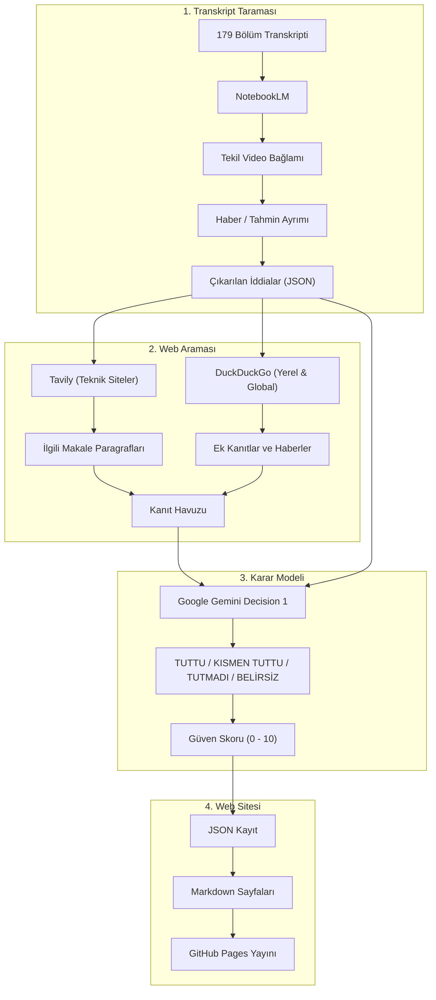

# Siber Alemden Havadisler (S.A.H) — Utku Şen Ne Kadar Haklı Çıktı?

Utku Şen'in YouTube'da sunduğu **"Siber Alemden Havadisler" (S.A.H)** serisini izleyenler bilir, haberleri aktarırken sık sık geleceğe dair kişisel tahminlerde bulunur: *"Göreceksiniz bu iş patlayacak"*, *"Devletler bunu kesin yasaklar"*, *"Bu teknoloji tutmaz"* gibi.

Bu projede 179 bölümlük serinin tüm transkriptlerini yapay zekaya tarattık. Utku'nun anlattığı haber bültenleri haricinde kendi tecrübesiyle ortaya attığı tahminleri çıkardık, ardından Tavily ve DuckDuckGo ile güncel web kaynaklarını tarayarak hangilerinin tutup hangilerinin tutmadığını test ettik.

Tüm sonuçları MkDocs ile hazırladığımız web sitesinden inceleyebilirsiniz:  
👉 **[Canlı Site: ytalharabaci.github.io/sah-ongoru-analizi](https://ytalharabaci.github.io/sah-ongoru-analizi/)**

---

## 🏗️ Nasıl Çalışıyor?

Süreç birbirini takip eden 4 adımdan oluşuyor:



### Adım Adım İşleyiş

1. **Öngörüleri Ayıklama (NotebookLM):** Videolar birbirine karışmasın diye her bölüm tek başına ele alınıyor. "Akamai Linode'u satın aldı" gibi şirket haberleri eleniyor, sadece Utku'nun kendi şahsi tahminleri toplanıyor.
2. **Kanıt Toplama (Tavily + DuckDuckGo):** İddia başına Tavily ile teknik sitelerden (BleepingComputer, The Hacker News vb.) doğrudan kanıt paragrafları çekiliyor. DuckDuckGo ile de Türkçe yerel kaynaklar taranarak havuz tamamlanıyor.
3. **Değerlendirme (Gemini Decision 1):** Model, iddiayı ve bulunan web kanıtlarını okuyup kararını veriyor. Olasılık dağılımına göre iddia `TUTTU`, `KISMEN TUTTU`, `TUTMADI` veya `BELİRSİZ` olarak sınıflandırılıyor. Eğer Utku "bu iş tutmaz" dediyse ve aradan geçen zamanda tutmadıysa, model bunu doğru şekilde `TUTTU` sayıyor.
4. **Siteye Dönüştürme (MkDocs Material):** Üretilen kanıtlar ve kararlar doğrudan Markdown dosyalarına yazılıyor, GitHub Actions ise siteyi derleyip yayına alıyor.

---

## ⚠️ Önemli Not (Yapay Zeka Uyarısı)

> [!WARNING]
> **Sonuçlara körü körüne güvenmeyin!**
> 
> Bu depodaki tüm iddia ayıklamaları, web aramaları ve doğruluk kararları **tamamen yapay zeka modelleri tarafından** üretildi. Modeller konuşma dilindeki esprileri, ironiyi ya da bağlamı bazen yanlış anlayabiliyor. Arama motorları da her zaman doğru haberi getiremeyebiliyor. 
>
> Bu çalışma Utku Şen'e bir karne çıkarma amacı taşımıyor. Hem siber güvenlik muhabbetlerini yad etmek hem de yapay zekanın araştırma yeteneklerini eğlenceli bir senaryoda test etmek için yapıldı. Hatalı gördüğünüz bir karar olursa Issue veya PR açarak katkıda bulunabilirsiniz.

---

## 🚀 Yerel Kurulum ve Çalıştırma

### 1. Gereksinimleri Yükleyin

```bash
pip install -r requirements.txt
playwright install chromium
```

### 2. NotebookLM Oturumu Açın

Google hesabınızla tarayıcı üzerinden giriş yapın:
```bash
python -m notebooklm login
```

### 3. API Anahtarlarını Ayarlayın

Kök dizinde `.env` dosyası oluşturup anahtarlarınızı yazın (örnek için `.env.example` dosyasına bakabilirsiniz):
```env
TAVILY_API_KEY=tvly-...
GEMINI_API_KEY=your_key_here
```

### 4. Analizi Başlatın

```bash
python sah_hibrit_final.py
```
*İşlem yarıda kesilirse endişelenmeyin, script kaldığı videodan devam edecek şekilde tasarlandı.*

### 5. Web Sitesini Önizleyin

Siteyi kendi bilgisayarınızda açmak için:
```bash
python -m mkdocs serve
```
Tarayıcınızda `http://127.0.0.1:8000` adresine giderek siteyi gezebilirsiniz.
