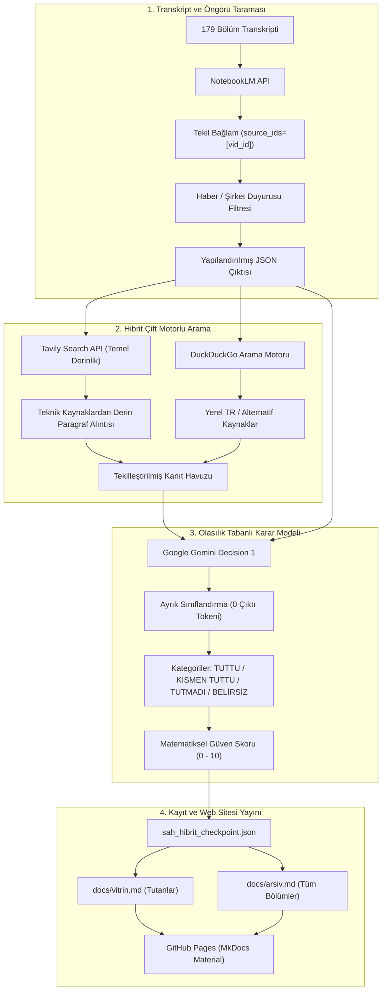

# Siber Alemden Havadisler (S.A.H) — Gelecek Öngörüleri Doğrulama Arşivi

Bu depo, **Utku Şen** tarafından hazırlanan haftalık siber güvenlik programı **"Siber Alemden Havadisler" (S.A.H)** yayınlarındaki şahsi teknoloji ve güvenlik öngörülerinin incelendiği açık kaynaklı bir yapay zeka araştırma ve doğrulama projesidir.

179 bölümden oluşan video serisinin transkriptleri yapay zeka ile taranmış; konuşmacının haberler üzerine yaptığı şahsi çıkarımlar ayıklanarak Tavily ve DuckDuckGo üzerinden toplanan kanıtlarla denetlenmiştir.

Raporlanan tüm sonuçlar **MkDocs Material** statik site oluşturucusu (SSG) ile GitHub Pages üzerinde sade, açık renkli ve okunabilir bir web sitesi olarak yayınlanmaktadır.

---

## 🏗️ Doğrulama Metodolojisi ve Mimarisi

Sistem, halüsinasyon riskini en aza indirmek ve şeffaflığı sağlamak amacıyla 4 aşamalı deterministik bir boru hattı üzerinden çalışır:



### Aşamaların İşleyişi:

1. **Aşama 1 (NotebookLM):** Videolar birbirine karıştırılmadan tek tek (`source_ids=[vid_id]`) taranır. Şirketlerin resmi satın alımları veya ürün duyuruları elenir; yalnızca Utku Şen'in kendi tecrübesiyle dile getirdiği şahsi öngörüler ayıklanır.
2. **Aşama 2 (Tavily + DuckDuckGo Hibrit Arama):**
   - **Tavily:** İddia başına İngilizce sorguyla teknik haber sitelerine (BleepingComputer, The Hacker News vb.) girerek doğrudan ilgili paragrafları (`content`) çeker.
   - **DuckDuckGo:** Yerel Türkçe haberleri ve alternatif küresel kaynakları tarayarak aynı URL'leri eler ve kanıt havuzunu tamamlar.
3. **Aşama 3 (Gemini Decision 1):** Karar modeli, toplanan makale alıntılarını ve video bağlamını okuyarak kalibre edilmiş matematiksel olasılıklarla iddiayı `TUTTU`, `KISMEN TUTTU`, `TUTMADI` veya `BELİRSİZ` olarak etiketler.
4. **Aşama 4 (Statik Site ve Raporlama):** Her iddia işlendiğinde atomik olarak JSON dosyasına kaydedilir ve anında GitHub Pages için Markdown sayfalarına dönüştürülür.

---

## ⚠️ Önemli Sorumluluk Reddi (Yapay Zeka Beyanı)

> [!WARNING]
> **Yapay Zeka Değerlendirmesi Hakkında Bilgilendirme**
> 1. **Tamamen Yapay Zeka Tarafından Üretilmiştir:** Bu depoda ve web sitesinde yer alan tüm iddia ayıklamaları, internet aramaları, kanıt alıntıları ve sınıflandırma kararları **insan müdahalesi olmaksızın otonom yapay zeka modelleri tarafından** üretilmiştir.
> 2. **Yüzde Yüz Güvenilirlik Garantisi Yoktur:** Doğal dil işleme modelleri konuşma dilindeki mecazları, şakaları veya yerel bağlamı zaman zaman yanlış yorumlayabilir; arama motorları ise konuyu tam yansıtmayan kaynaklar döndürebilir. Sonuçlar mutlak gerçeklik değil, bir model değerlendirmesidir.
> 3. **Amaç:** Bu çalışma şahsi bir karne veya bağlayıcı bir doğruluk sicili değildir; açık kaynaklı siber güvenlik arşivciliği ve yapay zeka tabanlı otonom araştırma yöntemlerini test etme amacı taşır.
> 4. **Düzeltmeler:** Hatalı veya eksik değerlendirildiğini düşündüğünüz iddialar için Issue veya Pull Request açabilirsiniz.

---

## 🚀 Kurulum ve Yerel Çalıştırma

### 1. Gereksinimler

```bash
pip install -r requirements.txt
playwright install chromium
```

### 2. Kimlik Doğrulama

NotebookLM oturumu için Google hesabınızla giriş yapın:
```bash
python -m notebooklm login
```

### 3. Pipeline'ı Çalıştırma

Tüm 179 videoyu taramak, arama yapmak ve kararları üretmek için:
```bash
python sah_hibrit_final.py
```
*Script kesintiye uğrasa dahi `sah_hibrit_checkpoint.json` üzerinden kaldığı videodan ve iddiadan devam eder.*

### 4. Web Sitesini Yerel Olarak Önizleme (SSG)

Sade, açık renkli MkDocs arayüzünü yerel tarayıcınızda görmek için:
```bash
python -m mkdocs serve
```
Tarayıcınızda `http://127.0.0.1:8000` adresini açarak siteyi inceleyebilirsiniz.

---

## 🌐 GitHub Pages Otomatik Yayını

Bu depoda `.github/workflows/deploy.yml` GitHub Actions iş akışı hazır bulunmaktadır. Depoyu GitHub'a `main` dalı üzerinden push ettiğinizde site otomatik olarak derlenip GitHub Pages üzerinden yayına alınır.
