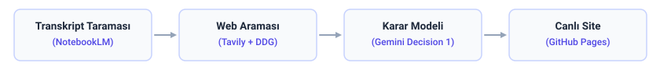

# S.A.H — Utku Şen Ne Kadar Haklı Çıktı?

Utku Şen'in YouTube'da sunduğu **"Siber Alemden Havadisler" (S.A.H)** serisini izleyenler bilir, haberleri aktarırken sık sık geleceğe dair kişisel tahminlerde bulunur: *"Göreceksiniz bu iş patlayacak"*, *"Devletler bunu kesin yasaklar"*, *"Bu teknoloji tutmaz"* gibi.

Bu projede 179 bölümlük serinin tüm transkriptlerini yapay zekaya tarattık. Utku'nun anlattığı haber bültenleri haricinde kendi tecrübesiyle ortaya attığı tahminleri çıkardık, ardından Tavily ve DuckDuckGo ile güncel web kaynaklarını tarayarak hangilerinin tutup hangilerinin tutmadığını test ettik.

Tüm sonuçları MkDocs ile hazırladığımız web sitesinden inceleyebilirsiniz:  
**[Canlı Site: ytalharabaci.github.io/sah-ongoru-analizi](https://ytalharabaci.github.io/sah-ongoru-analizi/)** | **[NotebookLM Kaynak Defteri](https://notebook.google.com/notebook/f2e75aa1-ef9d-4e1c-a281-95885383785a)**

---

## Önemli Not (Yapay Zeka Uyarısı)

> [!WARNING]
> **Sonuçlara körü körüne güvenmeyin!**
> 
> Bu depodaki tüm iddia ayıklamaları, web aramaları ve doğruluk kararları **tamamen yapay zeka modelleri tarafından** üretildi. Modeller konuşma dilindeki esprileri, ironiyi ya da bağlamı bazen yanlış anlayabiliyor. Arama motorları da her zaman doğru haberi getiremeyebiliyor. 
> 
> Bu çalışma Utku Şen'e karne ya da not verme amacı taşımıyor. Eski siber güvenlik muhabbetlerini hatırlamak ve yapay zekanın araştırma yeteneklerini eğlenceli bir senaryoda test etmek için yapıldı. Hatalı gördüğünüz bir karar olursa Issue veya PR açarak katkıda bulunabilirsiniz.

---

## Genel Sonuç Tablosu (179 Bölümün Özeti)

179 bölümün tamamı incelendi ve toplam **370 şahsi gelecek tahmini** değerlendirildi. Vadesi henüz dolmamış ya da hakkında kesin bir internet kanıtı bulunmayan 98 belirsiz tahmin ayrı tutuldu. Doğrulanan başarı oranı, akıbeti netleşmiş 272 tahmin üzerinden hesaplandı:

| Durum | Adet | Sonuçlananlar İçi Oran (272) | Tüm Liste İçi Oran (370) | Ortalama Güven | Anlamı |
| :--- | :---: | :---: | :---: | :---: | :--- |
| **TUTTU** | **150** | **%55.1** | %40.5 | 6.5 / 10 | İddia somut olarak gerçekleşti, teknik haberlerde ve web kaynaklarında net kanıtı var. |
| **KISMEN TUTTU** | **77** | **%28.3** | %20.8 | 4.7 / 10 | İddianın ana yönü doğru çıktı ancak zamanlama veya hedefte kısmi sapma oldu. |
| **TUTMADI** | **45** | **%16.5** | %12.2 | 6.9 / 10 | İddianın tam tersi gerçekleşti veya aradan geçen yıllara rağmen beklenti gerçekleşmedi. |
| **BELİRSİZ** | **98** | *Kapsam Dışı* | %26.5 | 5.6 / 10 | Web bulguları iddiayı doğrulamak ya da çürütmek için yetersiz kaldı veya iddianın vadesi henüz dolmadı. |
| **Sonuçlanan Tahminler** | **272** | **%100** | **%73.5** | - | **Doğrulanan Başarı (Tuttu + Kısmen): %83.5** |
| **Tüm Liste Toplamı** | **370** | - | **%100** | - | **Genel Oran (Belirsizler Dahil): %61.4** |

---

## Nasıl Çalışıyor?

<p align="center">
  
</p>

### Adım Adım İşleyiş

1. **Öngörüleri Ayıklama (notebooklm-py):** Google NotebookLM'in resmi bir geliştirici API'si bulunmuyor. Bu engeli aşmak için açık kaynaklı [notebooklm-py](https://github.com/tomaarsen/notebooklm-py) kütüphanesini kullandık. Kütüphane sayesinde tarayıcı oturumu üzerinden defterdeki 179 videonun transkriptini Python kodumuzla tek tek taratabildik. Videolar birbirine karışmasın diye her bölüm izole edildi. Taranan 179 videonun transkriptlerini barındıran açık deftere buradan ulaşabilirsiniz: [Google NotebookLM Defteri](https://notebook.google.com/notebook/f2e75aa1-ef9d-4e1c-a281-95885383785a). "Akamai Linode'u satın aldı" gibi şirket haberleri elendi, sadece Utku'nun kendi şahsi tahminleri toplandı.
2. **Kanıt Toplama (Tavily + DuckDuckGo):** İddia başına Tavily ile teknik sitelerden (BleepingComputer, The Hacker News vb.) doğrudan kanıt paragrafları çekiliyor. DuckDuckGo ile de Türkçe yerel kaynaklar taranarak havuz tamamlanıyor.
3. **Değerlendirme (Gemini Decision 1):** Model, iddiayı ve bulunan web kanıtlarını okuyup kararını veriyor. Olasılık dağılımına göre iddia `TUTTU`, `KISMEN TUTTU`, `TUTMADI` veya `BELİRSİZ` olarak sınıflandırılıyor. Eğer Utku "bu iş tutmaz" dediyse ve aradan geçen zamanda tutmadıysa, model bunu doğru şekilde `TUTTU` sayıyor.
4. **Siteye Dönüştürme (MkDocs Material):** Üretilen kanıtlar ve kararlar doğrudan Markdown dosyalarına yazılıyor, GitHub Actions ise siteyi derleyip yayına alıyor.

---

## Devasa Bağlam (Context Window) Sorununu Nasıl Çözdük?

179 bölümlük video serisinin toplam transkripti 200 saatin üzerinde konuşma, yüz binlerce satır metin ve on milyonlarca token tutuyor. 

Böylesi devasa bir arşivi tek bir yapay zeka oturumuna veya klasik bir RAG sistemine vermeye kalktığınızda üç büyük teknik sorunla karşılaşırsınız:
1. **Bağlam Patlaması ve Unutma:** En geniş pencereli modeller bile bu boyuttaki metinlerde "aradaki bilgiyi kaybetme" (lost in the middle) sendromuna girer, önemli detayları atlar.
2. **Bölümler Arası Karışıklık ve Halüsinasyon:** Model farklı bölümlerdeki benzer konuları birbirine karıştırır (örneğin 50. bölümdeki bir tartışmayı 150. bölümle birleştirip yanlış bağlam kurar).
3. **Yüzeysel Çıkarımlar:** Model her videonun satır aralarındaki o can alıcı spesifik tahminleri yakalamak yerine genel geçer yuvarlak cümleler üretir.

### Çözüm: notebooklm-py ile Tekil Kaynak İzolasyonu (`source_ids=[vid_id]`)

Google NotebookLM defterine 179 videonun tamamını yükledik ancak modele aynı anda tüm defteri sormadık. Açık kaynaklı `notebooklm-py` kütüphanesinin sunduğu kaynak filtreleme özelliğinden yararlanarak her istekte `source_ids=[vid_id]` parametresini kullandık.

Bu sayede:
- Arka plandaki model her döngüde sadece o an incelenen tek bir videonun tam transkriptine kilitlendi.
- Videonun başından sonuna kadarki tüm konuşma bağlamı, diğer 178 videodan gelen hiçbir gürültüye maruz kalmadan tertemiz okundu.
- Ne bağlam penceresi aşıldı ne de bölümler birbirine karıştı. 179 videonun tamamı tek tek, en ince ayrıntısına kadar taranabildi.

---

## Sıfır Maliyet Mimarisi (Tamamen Free Tier)

Bu projeyi tasarlarken temel amaçlardan biri de devasa dil modellerine veya ücretli API'lara yüzlerce dolar token parası kaptırmadan bu analizi bitirmekti. Tüm sistem tamamen ücretsiz katman sınırları (free tier) içinde kalacak şekilde optimize edildi:

- **notebooklm-py ve Google NotebookLM:** Normalde 179 YouTube videosunun yüzlerce saatlik transkriptini bir LLM'e okutmak devasa bir token faturası çıkarırdı. Açık kaynaklı `notebooklm-py` kütüphanesi sayesinde NotebookLM'in ücretsiz web oturumunu otomasyona bağladık ve milyonlarca tokenlik girdi maliyetini sıfıra indirdik.
- **Tavily AI (Aylık 1.000 Ücretsiz Kredi):** İddia başına sadece 1 kredi harcayacak şekilde kurgulandı. Tavily yalnızca en kritik İngilizce teknik sorguda derin paragraf çekmek için kullanılıyor, kotayı zorlamadan yüzlerce iddiaya fazlasıyla yetiyor.
- **DuckDuckGo:** Hem Türkçe yerel haberleri hem de alternatif kaynakları yakalamak için tamamen ücretsiz bir destekçi olarak çalışıyor, herhangi bir API ücreti yok.
- **Google Gemini Decision 1:** Google AI Studio'nun ücretsiz katmanında (200 RPM) çalışıyor. Üstelik metin üretimi yapmayıp sadece doğrudan olasılık dağılımı döndürdüğü için çıktı token maliyeti sıfır.
- **GitHub Pages:** Sitenin derlenmesi ve yayını GitHub Actions ve GitHub Pages'in ücretsiz kaynaklarıyla sağlanıyor.

---

## Yerel Kurulum ve Çalıştırma

### 1. Gereksinimleri Yükleyin

```bash
pip install -r requirements.txt
playwright install chromium
```

### 2. NotebookLM Oturumu Açın

Google hesabınızla tarayıcı üzerinden giriş yapın:
```bash
python -m notebooklm login
```

### 3. API Anahtarlarını Ayarlayın

Kök dizinde `.env` dosyası oluşturup anahtarlarınızı yazın (örnek için `.env.example` dosyasına bakabilirsiniz):
```env
TAVILY_API_KEY=tvly-...
GEMINI_API_KEY=your_key_here
```

### 4. Analizi Başlatın

```bash
python sah_karar.py
```
*İşlem yarıda kesilirse endişelenmeyin, script kaldığı videodan devam edecek şekilde tasarlandı.*

### 5. Web Sitesini Önizleyin

Siteyi kendi bilgisayarınızda açmak için:
```bash
python -m mkdocs serve
```
Tarayıcınızda `http://127.0.0.1:8000` adresine giderek siteyi gezebilirsiniz.
