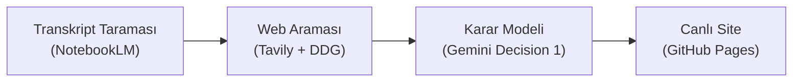

# Gelecek Öngörüleri Analizi

Utku Şen'in YouTube'da sunduğu **"Siber Alemden Havadisler" (S.A.H)** serisini takip edenler bilir, haftalık siber güvenlik haberlerini yorumlarken geleceğe dair sık sık şahsi öngörülerde bulunur.

Bu açık kaynaklı çalışmada 179 bölümlük serinin tüm video transkriptleri yapay zekaya taratıldı. Utku'nun haberler haricinde kendi tecrübesiyle dile getirdiği şahsi tahminler ayıklandı ve güncel internet kanıtlarıyla hangilerinin tutup hangilerinin tutmadığı test edildi.

  

    
179

    
Taranan Video

    
Bölüm Başına Tekil Bağlam

  

  

    
272

    
Sonuçlanan Tahmin

    
370 İddia içinden 98'i Belirsiz

  

  

    
%83.5

    
Doğrulanan Başarı Oranı

    
150 Tuttu + 77 Kısmen Tuttu

  

  

    
%16.5

    
Yanılma Oranı

    
Yalnızca 45 İddia Tutmadı

  

  <a href="arsiv/" class="btn-primary">Tahminleri İncele (370 İddia)</a>
  <a href="metodoloji/" class="btn-secondary">Metodoloji</a>

---

## Önemli Not (Yapay Zeka Uyarısı)

!!! warning "Sonuçlara körü körüne güvenmeyin!"
    - **Tamamen Yapay Zeka Tarafından Üretildi:** Bu sitedeki tüm özetler, internet aramaları ve doğruluk kararları insan editör müdahalesi olmadan yapay zeka modelleri tarafından oluşturuldu.
    - **Yüzde Yüz Güvenilirlik Garantisi Yok:** Modeller konuşma dilindeki esprileri veya kinayeli ifadeleri bazen yanlış yorumlayabiliyor, arama motorları da konudan alakasız sayfalar getirebiliyor. Sonuçlar mutlak bir hakikat değil, model değerlendirmesidir.
    - **Amaç:** Bu çalışma Utku Şen'e bir karne çıkarma amacı taşımıyor. Siber güvenlik muhabbetlerini yad etmek ve yapay zeka ajanlarının araştırma kabiliyetini eğlenceli bir senaryoda denemek için hazırlandı.

---

## Genel Sonuç Tablosu (179 Bölümün Özeti)

179 bölümün tamamı tarandı ve toplam **370 adet şahsi gelecek tahmini** değerlendirildi. Tahmin piyasaları metodolojisine uygun olarak, vadesi henüz dolmayan veya açık web kanıtı bulunmayan 98 belirsiz iddia başarı oranını olumsuz etkilememesi için paydadan muaf tutulmuştur:

  

    <svg viewBox="0 0 200 200" class="donut-chart" width="210" height="210">
      <circle cx="100" cy="100" r="70" fill="transparent" stroke="#f1f5f9" stroke-width="26" />
      <circle cx="100" cy="100" r="70" fill="transparent" stroke="#10b981" stroke-width="26"
              stroke-dasharray="242.55 439.82" stroke-dashoffset="0"
              transform="rotate(-90 100 100)" class="donut-segment seg-tuttu" />
      <circle cx="100" cy="100" r="70" fill="transparent" stroke="#f59e0b" stroke-width="26"
              stroke-dasharray="124.51 439.82" stroke-dashoffset="-242.55"
              transform="rotate(-90 100 100)" class="donut-segment seg-kismen" />
      <circle cx="100" cy="100" r="70" fill="transparent" stroke="#ef4444" stroke-width="26"
              stroke-dasharray="72.76 439.82" stroke-dashoffset="-367.06"
              transform="rotate(-90 100 100)" class="donut-segment seg-tutmadi" />
      <text x="100" y="93" text-anchor="middle" font-size="28" font-weight="800" fill="#0f172a">%83.5</text>
      <text x="100" y="113" text-anchor="middle" font-size="11" font-weight="700" fill="#059669" letter-spacing="0.5">BAŞARI ORANI</text>
      <text x="100" y="128" text-anchor="middle" font-size="9.5" fill="#64748b">272 Karar Üzerinden</text>
    </svg>
  

  

    
Sonuçlanan 272 Tahminin Karar Dağılımı

    

      

        
        Tuttu
      

      

        150 İddia
        %55.1
      

    

    

      

        
        Kısmen Tuttu
      

      

        77 İddia
        %28.3
      

    

    

      

        
        Tutmadı
      

      

        45 İddia
        %16.5
      

    

    

      <strong>Metodolojik Not:</strong> Vadesi henüz dolmayan veya açık web kanıtı bulunmayan <strong>98 tahmin</strong> (Belirsiz), başarı oranını yapay olarak aşağı çekmemesi için paydadan muaf tutulmuştur.
    

  

| Durum | Adet | Sonuçlananlar İçi Oran (272) | Tüm Arşiv İçi Oran (370) | Ortalama Güven | Anlamı |
| :--- | :---: | :---: | :---: | :---: | :--- |
| TUTTU | **150** | **%55.1** | %40.5 | 6.5 / 10 | İddia somut olarak gerçekleşti, teknik haberlerde ve web kaynaklarında net kanıtı var. |
| KISMEN TUTTU | **77** | **%28.3** | %20.8 | 4.7 / 10 | İddianın ana yönü doğru çıktı ancak zamanlama veya hedefte kısmi sapma oldu. |
| TUTMADI | **45** | **%16.5** | %12.2 | 6.9 / 10 | İddianın tam tersi gerçekleşti veya aradan geçen yıllara rağmen beklenti gerçekleşmedi. |
| BELİRSİZ | **98** | *Kapsam Dışı* | %26.5 | 5.6 / 10 | Web bulguları iddiayı doğrulamak ya da çürütmek için yetersiz kaldı veya iddianın vadesi henüz dolmadı. |
| **Sonuçlanan Tahminler** | **272** | **%100** | **%73.5** | - | **Doğrulanan Başarı (Tuttu + Kısmen): %83.5** |
| **Tüm Arşiv Toplamı** | **370** | - | **%100** | - | **Genel Oran (Belirsizler Dahil): %61.4** |

---

## Öne Çıkan Bazı Tahminler

Seride öne çıkan farklı nitelikteki tahminlerden birkaç örnek:

  

    

      TUTTU
      Güven: 9.3/10
    

    
Bill Demirkapı ve Büyük Şirketler

    
Utku, genç güvenlik araştırmacısı Bill Demirkapı'nın yakın zamanda büyük bir teknoloji devinin güvenlik ekibine katılacağını öngördü. Bill Demirkapı kısa süre sonra Microsoft güvenlik ekibinde araştırmacı olarak çalışmaya başladı.

    
<a href="arsiv/">Tahmini incele &rarr;</a>

  

  

    

      KISMEN TUTTU
      Güven: 8.5/10
    

    
İş Mülakatlarında Yapay Zeka Hilesi

    
Uzaktan teknik mülakatlarda adayların yapay zeka araçları kullanarak canlı kodlama hilesi yapacağını ve şirketlerin buna karşı ek sınav önlemleri geliştirmek zorunda kalacağını tahmin etti. Sektörde yaygınlaştı ve şirketler önlem almaya başladı.

    
<a href="arsiv/">Tahmini incele &rarr;</a>

  

  

    

      TUTMADI
      Güven: 7.2/10
    

    
Avrupa'da Haftada 4 Gün Çalışma

    
Belçika'nın ardından Fransa, Almanya ve Hollanda gibi ülkelerin 5 yılı bulmadan haftada 4 gün çalışma modeline yasal olarak geçeceğini öngördü. Bazı şirketler ve pilot denemeler olsa da AB genelinde yasal model haline gelmedi.

    
<a href="arsiv/">Tahmini incele &rarr;</a>

  

---

## Nasıl Çalışıyor?

1. **NotebookLM:** Videolar birbirine karışmadan tek tek taranıyor. Şirketlerin basın bültenleri elenip sadece Utku'nun kendi tahminleri toplanıyor. Taranan 179 videonun transkriptlerini barındıran açık defteri buradan inceleyebilirsiniz: **[Google NotebookLM Defteri](https://notebook.google.com/notebook/f2e75aa1-ef9d-4e1c-a281-95885383785a)**
2. **Tavily ve DuckDuckGo:** Teknik sitelerden doğrudan ilgili makale paragrafları çekiliyor, Türkçe yerel haberlerle kanıt havuzu tamamlanıyor.
3. **Gemini Decision 1:** Model, iddiayı ve web bulgularını inceleyerek olasılık dağılımı üzerinden nihai kararını veriyor.
4. **MkDocs:** Sonuçlar anında web sayfalarına işleniyor ve GitHub Pages üzerinden yayınlanıyor.

Daha fazla teknik detay için **[Metodoloji](metodoloji.md)** sayfasına göz atabilirsiniz.
