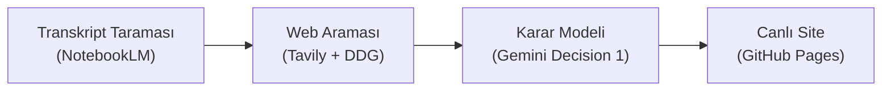

# Siber Alemden Havadisler (S.A.H) — Gelecek Öngörüleri Analizi

Utku Şen'in YouTube'da sunduğu **"Siber Alemden Havadisler" (S.A.H)** yayınlarını takip edenler bilir, haftalık siber güvenlik haberlerini yorumlarken geleceğe dair sık sık şahsi tahminlerde bulunur.

Bu sitede 179 bölümlük video serisinin transkriptleri yapay zekaya taratıldı. Utku'nun anlattığı haberlerin ötesinde kendi tecrübesiyle yaptığı şahsi tahminler ayıklandı ve güncel internet haberleriyle doğrulanıp doğrulanmadığı kontrol edildi.

---

## 📊 Değerlendirme Kategorileri

| Kategori | Anlamı |
| :--- | :--- |
| TUTTU | İddia somut olarak gerçekleşti, teknik haberlerde ve web kaynaklarında net kanıtı var. |
| KISMEN TUTTU | İddianın ana yönü doğru çıktı ancak zamanlama veya hedefte kısmi sapma oldu. |
| TUTMADI | İddianın tam tersi gerçekleşti veya aradan geçen yıllara rağmen beklenti gerçekleşmedi. |
| BELİRSİZ | Web bulguları iddiayı doğrulamak ya da çürütmek için yetersiz kaldı veya iddianın vadesi henüz dolmadı. |

- Doğrulanan tahminler için: **[Tutan Öngörüler (Vitrin)](vitrin.md)**
- Tüm bölümler ve detaylar için: **[Tüm Karar Arşivi](arsiv.md)**

---

## 🏗️ Nasıl Çalışıyor?

1. **NotebookLM:** Videolar birbirine karışmadan tek tek taranıyor. Şirketlerin resmi duyuruları elenip sadece Utku'nun kendi tahminleri toplanıyor.
2. **Tavily ve DuckDuckGo:** Teknik sitelerden doğrudan ilgili makale paragrafları çekiliyor, Türkçe yerel haberlerle kanıt havuzu tamamlanıyor.
3. **Gemini Decision 1:** Model, iddiayı ve web bulgularını inceleyerek olasılık dağılımı üzerinden nihai kararını veriyor.
4. **MkDocs:** Sonuçlar anında web sayfalarına işleniyor.

Daha fazla teknik detay için **[Metodoloji ve Şeffaflık](metodoloji.md)** sayfasına göz atabilirsiniz.

---

## ⚠️ Önemli Not (Yapay Zeka Uyarısı)

!!! warning "Sonuçlara körü körüne güvenmeyin!"
    - **Tamamen Yapay Zeka Tarafından Üretildi:** Bu sitedeki tüm özetler, internet aramaları ve doğruluk kararları insan editör müdahalesi olmadan yapay zeka modelleri tarafından oluşturuldu.
    - **Yüzde Yüz Güvenilirlik Garantisi Yok:** Modeller konuşma dilindeki esprileri veya kinayeli ifadeleri bazen yanlış yorumlayabiliyor, arama motorları da konudan alakasız sayfalar getirebiliyor. Sonuçlar mutlak gerçeklik değil, bir model değerlendirmesidir.
    - **Amaç:** Bu çalışma Utku Şen'e bir karne çıkarma amacı taşımıyor. Siber güvenlik muhabbetlerini hatırlamak ve yapay zeka ajanlarının araştırma kabiliyetini eğlenceli bir projede denemek için hazırlandı.
