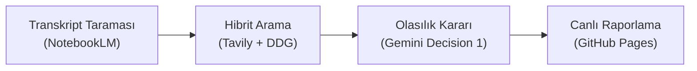

# Siber Alemden Havadisler — Gelecek Öngörüleri Analizi

Bu proje, **Utku Şen** tarafından hazırlanan ve sunulan haftalık siber güvenlik programı **"Siber Alemden Havadisler" (S.A.H)** yayınlarındaki şahsi teknoloji ve güvenlik öngörülerinin incelendiği açık kaynaklı bir doğrulama çalışmasıdır.

179 bölümden oluşan video serisinin transkriptleri otonom yapay zeka boru hattı ile taranmış; konuşmacının haberler üzerine yaptığı şahsi gelecek projeksiyonları ayıklanarak güncel web kanıtlarıyla denetlenmiştir.

---

## 📊 Güncel Değerlendirme Özeti

Aşağıdaki tablo, analiz edilen bölümlerden çıkarılan iddiaların güncel doğrulama durumunu göstermektedir:

| Durum | Açıklama |
| :--- | :--- |
| TUTTU | İddia somut olarak gerçekleşti; teknik haberlerde ve web kanıtlarında net delili var. |
| KISMEN TUTTU | İddianın ana istikameti doğru çıktı ancak zamanlama, hedef veya kapsamda kısmi sapma mevcut. |
| TUTMADI | İddianın tam tersi gerçekleşti veya aradan geçen zamana rağmen beklenti gerçekleşmedi. |
| BELİRSİZ | Web bulguları iddiayı doğrulamak/çürütmek için yetersiz ya da iddianın vadesi henüz dolmadı. |

- Doğrulanan başarılı öngörüler için: **[Tutan Öngörüler (Vitrin)](vitrin.md)**
- Tüm bölümler ve değerlendirmeler için: **[Tüm Karar Arşivi](arsiv.md)**

---

## 🏗️ Doğrulama Mimarisi

Sistem, 4 bağımsız aşamadan oluşan deterministik ve olasılıksal bir boru hattı üzerinden çalışır:

1. **Aşama 1 (NotebookLM):** Videolar tek tek taranır. Şirket bültenleri elenir, sadece konuşmacının kendi gelecek tahminleri ayıklanır.
2. **Aşama 2 (Tavily + DuckDuckGo):** Tavily ile teknik haber sitelerinden derin kanıt paragrafları çekilir; DuckDuckGo ile yerel kaynaklar taranır.
3. **Aşama 3 (Gemini Decision 1):** Toplanan kanıtlar ve video bağlamı Bayesçi karar modeline gönderilerek kalibre edilmiş olasılıklar hesaplanır.
4. **Aşama 4 (Statik Site):** Bulgular atomik olarak kaydedilir ve MkDocs ile GitHub Pages üzerinden yayınlanır.

Detaylı teknik akış şeması ve prompt yapısı için **[Metodoloji ve Şeffaflık](metodoloji.md)** sayfasını inceleyebilirsiniz.

---

## ⚠️ Önemli Sorumluluk Reddi (Yasal ve Metodolojik Beyan)

!!! warning "Yapay Zeka Değerlendirmesi Hakkında Bilgilendirme"
    - **Tamamen Yapay Zeka Tarafından Üretilmiştir:** Bu sitede sunulan tüm iddia özetleri, web aramaları, kanıt alıntıları ve doğruluk kararları insan editör müdahalesi olmadan otonom yapay zeka modelleri tarafından oluşturulmuştur.
    - **Yüzde Yüz Güvenilirlik Garantisi Yoktur:** Doğal dil işleme modelleri konuşma dilindeki mecazları, şakaları veya ironiyi bazen kaçırabilir; arama motorları ise konuyu tam yansıtmayan kaynaklar döndürebilir. Bu nedenle sonuçlar mutlak gerçeklik değil, bir model değerlendirmesidir.
    - **Amaç ve Nitelik:** Bu çalışma kişisel bir karne veya bağlayıcı bir doğruluk sicili değildir; açık kaynaklı siber güvenlik arşivciliği ve yapay zeka doğrulama deneyidir.
