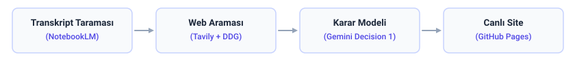

# Gelecek Öngörüleri Analizi

Utku Şen'in YouTube'da sunduğu **"Siber Alemden Havadisler" (S.A.H)** serisini takip edenler bilir, haftalık siber güvenlik haberlerini yorumlarken geleceğe dair sık sık şahsi öngörülerde bulunur.

Bu çalışmada 179 bölümlük serinin tüm konuşma metinleri yapay zekaya taratıldı. Utku'nun haber bültenleri haricinde kendi tecrübesiyle dile getirdiği şahsi tahminler ayıklandı ve güncel internet kanıtlarıyla hangilerinin tutup hangilerinin tutmadığı test edildi.

  

    
179

    
Taranan Video

    
Bölüm Başına Tekil Bağlam

  

  

    
272

    
Sonuçlanan Tahmin

    
370 İddia içinden 98'i Belirsiz

  

  

    
%83.5

    
Doğrulanan Başarı Oranı

    
150 Tuttu + 77 Kısmen Tuttu

  

  <a href="arsiv/" class="btn-primary">Tahminleri İncele (370 İddia)</a>
  <a href="metodoloji/" class="btn-secondary">Metodoloji</a>

---

## Önemli Not (Yapay Zeka Uyarısı)

!!! warning "Sonuçlara körü körüne güvenmeyin!"
    - **Tamamen Yapay Zeka Tarafından Üretildi:** Bu sitedeki tüm özetler, internet aramaları ve doğruluk kararları insan editör müdahalesi olmadan yapay zeka modelleri tarafından oluşturuldu.
    - **Yüzde Yüz Güvenilirlik Garantisi Yok:** Modeller konuşma dilindeki esprileri veya kinayeli ifadeleri bazen yanlış yorumlayabiliyor, arama motorları da konudan bağımsız sayfalar getirebiliyor. Sonuçlar mutlak kesin bir doğru değil, model değerlendirmesidir.
    - **Amaç:** Bu çalışma Utku Şen'e karne ya da not verme amacı taşımıyor. Eski siber güvenlik muhabbetlerini anmak ve yapay zekanın araştırma yeteneklerini eğlenceli bir senaryoda denemek için hazırlandı.

---

## Genel Sonuç Tablosu (179 Bölümün Özeti)

179 bölümün tamamı incelendi ve toplam **370 şahsi gelecek tahmini** değerlendirildi. Henüz vadesi gelmemiş veya hakkında net bir internet kanıtı bulunmayan 98 belirsiz tahmin ayrı bir grupta tutuldu. Doğrulanan başarı oranı, akıbeti netleşmiş olan 272 tahmin üzerinden hesaplandı:

  

    
%40.5

    
%20.8

    
%12.2

    
%26.5

  

  

     Tuttu (150)
     Kısmen Tuttu (77)
     Tutmadı (45)
     Belirsiz (98)
  

| Durum | Tahmin Sayısı | Netleşen Oran (272) | Tüm Arşiv Payı (370) | Açıklama |
| :--- | :---: | :---: | :---: | :--- |
| TUTTU | **150** | **%55.1** | %40.5 | Somut olarak gerçekleşti, açık web kaynaklarıyla doğrulandı. |
| KISMEN TUTTU | **77** | **%28.3** | %20.8 | Ana fikir doğru çıktı, detay veya zamanda kısmi sapma oldu. |
| TUTMADI | **45** | **%16.5** | %12.2 | Gerçekleşmedi veya beklentinin tam aksi yönde gelişti. |
| **Doğrulanan Başarı (Tuttu + Kısmen)** | **227 / 272** | **%83.5** | **%61.4** | **Sonucu netleşen 272 tahminin 227'si başarıyla doğrulandı.** |
| BELİRSİZ | **98** | *Vadesi Dolmadı* | %26.5 | Vadesi henüz dolmadı (ör. 2028-2030) veya kanıtlar yetersiz. |
| **Toplam Değerlendirilen Arşiv** | **370** | - | **%100** | **179 video serisinden ayıklanan tüm şahsi tahmin havuzu.** |

---

## Nasıl Çalışıyor?

1. **NotebookLM:** Videolar birbirine karışmadan tek tek taranıyor. Şirketlerin basın bültenleri elenip sadece Utku'nun kendi tahminleri toplanıyor. Taranan 179 videonun konuşma metinlerini içeren deftere buradan doğrudan göz atabilirsiniz: **[Google NotebookLM Defteri](https://notebook.google.com/notebook/f2e75aa1-ef9d-4e1c-a281-95885383785a)**
2. **Tavily ve DuckDuckGo:** Teknik sitelerden doğrudan ilgili makale paragrafları çekiliyor, Türkçe yerel haberlerle kanıt havuzu tamamlanıyor.
3. **Gemini Decision 1:** Model, iddiayı ve web bulgularını inceleyerek olasılık dağılımı üzerinden nihai kararını veriyor.
4. **MkDocs:** Sonuçlar anında web sayfalarına işleniyor ve GitHub Pages üzerinden yayınlanıyor.

Daha fazla teknik detay için **[Metodoloji](metodoloji.md)** sayfasına göz atabilirsiniz.
