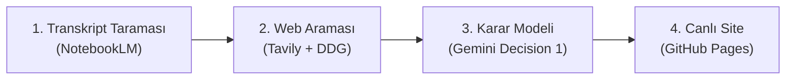

# Doğrulama Metodolojisi ve Yapay Zeka Mimarisi

Bu çalışma, **Utku Şen** tarafından hazırlanan haftalık siber güvenlik programı **"Siber Alemden Havadisler" (S.A.H)** serisindeki şahsi tahminlerin incelendiği 4 adımlı bir yapay zeka akışıdır.

---

## Doğrulama Akışı

---

## Aşamaların Detayları

### 1. Aşama: Tekil Bağlam Taraması (notebooklm-py ve Kaynak İzolasyonu)

- **Context Window Sorunu:** 179 video ve 200 saati aşkın transkript tek bir modele verildiğinde hem token limitleri zorlanır hem de model bölümleri birbirine karıştırarak hayali bağlantılar kurabilir.
- **Kaynak İzolasyonu (`source_ids=[vid_id]`):** Açık kaynaklı `notebooklm-py` kütüphanesiyle Google NotebookLM defterindeki her videoya tek tek istek atıldı. Model her defasında yalnızca tek bir videonun tam transkriptine odaklandı, diğer 178 bölümün gürültüsünden izole edildi.
- **Haber ve Tahmin Ayrımı:** Akamai'nin Linode'u satın alması veya bir şirketin güvenlik yaması yayınlaması gibi gelişmeler birer haberdir ve elendi. Yalnızca Utku'nun haberler üzerine eklediği şahsi tezler ve gelecek projeksiyonları ayıklandı.
- **Oynatma Listesini Deftere Aktarma:** YouTube oynatma listesindeki 179 videonun bağlantılarını tek tek elle eklemek yerine [TunePocket Playlist to Text Converter](https://www.tunepocket.com/youtube-playlist-to-text-converter/) aracı kullanıldı. Tüm video bağlantıları tek seferde çıkarılıp NotebookLM'e topluca yapıştırıldı ve sistem transkriptleri otomatik olarak içe aktardı.
- **Açık Kaynak Defter:** Analizde taranan 179 YouTube videosunun tam transkriptlerini barındıran halka açık defteri doğrudan inceleyebilirsiniz: **[Google NotebookLM Defteri](https://notebook.google.com/notebook/f2e75aa1-ef9d-4e1c-a281-95885383785a)**

### 2. Aşama: Hibrit Arama (Tavily + DuckDuckGo)

- **Tavily (Birincil):** İngilizce aramayla BleepingComputer, The Hacker News gibi kaynaklardan doğrudan kanıt paragraflarını çeker.
- **DuckDuckGo (İkincil):** Yerel Türkçe haberleri ve alternatif kaynakları tarar, aynı bağlantıları eleyerek kanıt havuzunu tamamlar.

### 3. Aşama: Karar Modeli (`gemini-decision-1`)

- Geleneksel metin üreten modeller yerine, doğrudan ayrık kategoriler üzerinden olasılık dağılımı üreten Google Gemini Decision 1 modeli kullanılır.
- **Karar Sınıfları:**
  - **TUTTU:** Öngörü somut olarak gerçekleşti ve web kanıtlarında net delili var.
  - **KISMEN TUTTU:** Öngörünün ana yönü doğru çıktı ancak kapsam veya zamanlamada kısmi sapma oldu.
  - **TUTMADI:** Öngörünün tam tersi gerçekleşti veya aradan geçen makul zamana rağmen beklenti gerçekleşmedi.
  - **BELİRSİZ:** Web bulguları iddiayı doğrulamak ya da çürütmek için yetersiz veya vadesi henüz dolmadı.
- **Negatif İddia Kuralı:** Eğer Utku bir teknolojinin tutmayacağını veya engelleneceğini söylediyse ve aradan geçen zamanda o şey gerçekten tutmadıysa, iddia haklı olarak `TUTTU` kabul edilir.

### 4. Aşama: Sıfır Maliyet ve Free Tier Mimarisi

Bu analizi yürütürken pahalı kurumsal API'lara veya yüksek token faturalarına girmeden tamamen ücretsiz katmanlar (free tier) kullanıldı:

- **NotebookLM:** 179 bölümün tüm transkriptleri ücretsiz oturum üzerinden tarandı, böylece milyonlarca tokenlik girdi maliyeti sıfırlandı.
- **Tavily AI (1.000 Ücretsiz Kredi):** İddia başına yalnızca 1 kredi harcandı, en kritik İngilizce teknik sorguyla zengin kanıtlar çekildi.
- **DuckDuckGo:** Tamamen ücretsiz arama altyapısı sayesinde ek yerel kaynaklar tek kuruş ödemeden toplandı.
- **Gemini Decision 1:** Google AI Studio'nun ücretsiz katmanında çalıştırıldı, metin üretimi yerine ayrık olasılık döndürdüğü için çıktı token maliyeti sıfır oldu.
- **GitHub Pages:** Sitenin barındırılması ve otomatik derlenmesi GitHub'ın ücretsiz açık kaynak altyapısıyla sağlandı.

---

## Önemli Not (Yapay Zeka Uyarısı)

!!! warning "Sonuçlara körü körüne güvenmeyin!"
    - **Tamamen Yapay Zeka Tarafından Üretildi:** Bu sitedeki tüm özetler, internet aramaları ve doğruluk kararları insan editör müdahalesi olmadan yapay zeka modelleri tarafından oluşturuldu.
    - **Yüzde Yüz Güvenilirlik Garantisi Yok:** Modeller konuşma dilindeki esprileri veya kinayeli ifadeleri bazen yanlış yorumlayabiliyor, arama motorları da konudan alakasız sayfalar getirebiliyor. Sonuçlar mutlak gerçeklik değil, bir model değerlendirmesidir.
    - **Amaç:** Bu çalışma Utku Şen'e bir karne çıkarma amacı taşımıyor. Siber güvenlik muhabbetlerini hatırlamak ve yapay zeka ajanlarının araştırma kabiliyetini eğlenceli bir projede denemek için hazırlandı.
    - **Düzeltmeler:** Yanlış değerlendirildiğini düşündüğünüz maddeler için GitHub üzerinden Issue veya Pull Request açabilirsiniz.
