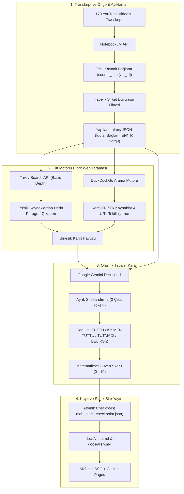

# Doğrulama Metodolojisi ve Yapay Zeka Mimarisi

Bu çalışma, **Utku Şen** tarafından hazırlanan haftalık siber güvenlik programı **"Siber Alemden Havadisler" (S.A.H)** yayınlarındaki şahsi öngörü ve çıkarımların incelendiği 4 aşamalı bir yapay zeka boru hattıdır.

---

## 🏗️ 4 Aşamalı Doğrulama Akışı

---

## Aşama Detayları

### 1. Aşama: Tekil Bağlam Taraması (NotebookLM)

- **İzolasyon:** 179 video transkripti aynı anda sorulduğunda modeller bağlamları karıştırabileceğinden, her bölüm tekil olarak `source_ids=[vid_id]` parametresiyle taranır.
- **Haber / Tahmin Ayrımı:** Akamai'nin Linode'u satın alması veya bir firmanın yama çıkarması gibi olaylar şirketin resmi eylemidir ve elenir. **Yalnızca konuşmacının haber üzerine eklediği şahsi tezler ve gelecek projeksiyonları** çıkarılır.

### 2. Aşama: Hibrit Arama (Tavily + DuckDuckGo)

- **Tavily (Birincil):** İngilizce teknik sorguyla BleepingComputer, The Hacker News vb. sitelerden iddiayla ilgili paragrafları (`content`) temiz markdown olarak çeker (iddia başına 1 kredi).
- **DuckDuckGo (İkincil):** Yerel Türkçe haberler ve alternatif küresel kaynakları tarar. Aynı URL'leri eleyerek tekil kanıt havuzunu zenginleştirir.

### 3. Aşama: Bayesçi Karar (`gemini-decision-1`)

- Geleneksel metin üreten modeller yerine, doğrudan ayrık kategoriler üzerinde olasılık üreten **gemini-decision-1** modeli kullanılır.
- **Karar Sınıfları:**
  - **TUTTU:** Öngörü yayından sonraki süreçte somut olarak gerçekleşti ve web kanıtlarında net delili var.
  - **KISMEN TUTTU:** Öngörünün ana yönü doğru çıktı; ancak kapsam, hedef veya zamanlamada kısmi sapma oldu.
  - **TUTMADI:** Öngörünün tam tersi gerçekleşti veya aradan geçen makul zamana rağmen beklenti boşa çıktı.
  - **BELİRSİZ:** Web bulguları iddiayı doğrulamak/çürütmek için yetersiz ya da vadesi henüz dolmadı.
- **Negatif İddia Kuralı:** Eğer konuşmacı bir teknolojinin tutmayacağını, engelleneceğini veya bir olayın gerçekleşmeyeceğini öngörmüşse ve o şey gerçekleşmemişse, iddia `TUTTU` olarak sınıflandırılır.

---

## ⚠️ Önemli Sorumluluk Reddi (Yapay Zeka Beyanı)

!!! warning "Yapay Zeka Değerlendirme Beyanı ve Yasal Uyarı"
    1. **Tamamen Otonom Üretim:** Bu sitedeki tüm iddia ayıklamaları, internet aramaları, kanıt alıntıları ve doğruluk kararları **insan editör müdahalesi olmaksızın yapay zeka modelleri tarafından** üretilmiştir.
    2. **Yüzde Yüz Güvenilirlik Garantisi Yoktur:** Doğal dil işleme modelleri konuşma dilindeki mecazları, şakaları veya ironiyi bazen kaçırabilir; arama motorları ise konuyu tam yansıtmayan kaynaklar döndürebilir. Bu nedenle sonuçlar mutlak gerçeklik değil, bir model değerlendirmesidir.
    3. **Amaç ve Nitelik:** Bu çalışma kişisel bir karne veya bağlayıcı bir doğruluk sicili değildir; açık kaynaklı siber güvenlik arşivciliği ve yapay zeka doğrulama deneyidir.
    4. **Düzeltme Talepleri:** Hatalı veya eksik değerlendirildiğini düşündüğünüz maddeler için GitHub reposu üzerinden Issue veya Pull Request açabilirsiniz.
