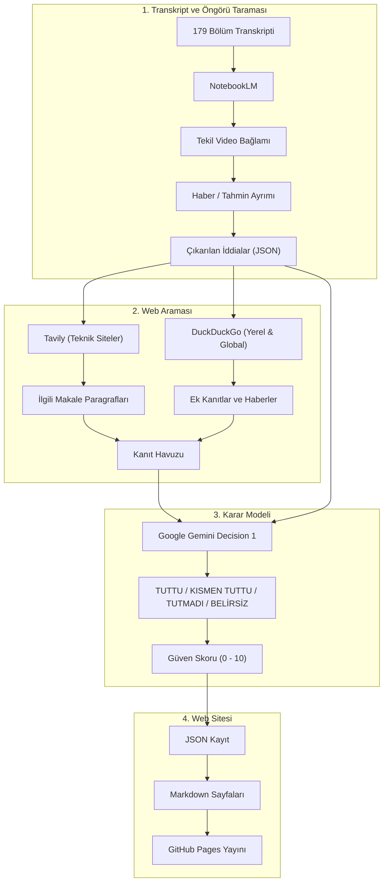

# Doğrulama Metodolojisi ve Yapay Zeka Mimarisi

Bu çalışma, **Utku Şen** tarafından hazırlanan haftalık siber güvenlik programı **"Siber Alemden Havadisler" (S.A.H)** serisindeki şahsi tahminlerin incelendiği 4 adımlı bir yapay zeka akışıdır.

---

## 🏗️ 4 Adımlı Doğrulama Akışı

---

## Aşamaların Detayları

### 1. Aşama: Tekil Bağlam Taraması (NotebookLM)

- **İzolasyon:** 179 video aynı anda modele verildiğinde bağlamlar karışabildiği için her bölüm tek tek ele alınıyor.
- **Haber ve Tahmin Ayrımı:** Akamai'nin Linode'u satın alması veya bir şirketin güvenlik yaması yayınlaması gibi gelişmeler birer haberdir ve elenir. Yalnızca Utku'nun haberler üzerine eklediği şahsi tezler ve gelecek projeksiyonları toplanır.

### 2. Aşama: Hibrit Arama (Tavily + DuckDuckGo)

- **Tavily (Birincil):** İngilizce aramayla BleepingComputer, The Hacker News gibi kaynaklardan doğrudan kanıt paragraflarını çeker.
- **DuckDuckGo (İkincil):** Yerel Türkçe haberleri ve alternatif kaynakları tarar, aynı bağlantıları eleyerek kanıt havuzunu tamamlar.

### 3. Aşama: Karar Modeli (`gemini-decision-1`)

- Geleneksel metin üreten modeller yerine, doğrudan ayrık kategoriler üzerinden olasılık dağılımı üreten Google Gemini Decision 1 modeli kullanılır.
- **Karar Sınıfları:**
  - **TUTTU:** Öngörü somut olarak gerçekleşti ve web kanıtlarında net delili var.
  - **KISMEN TUTTU:** Öngörünün ana yönü doğru çıktı ancak kapsam veya zamanlamada kısmi sapma oldu.
  - **TUTMADI:** Öngörünün tam tersi gerçekleşti veya aradan geçen makul zamana rağmen beklenti gerçekleşmedi.
  - **BELİRSİZ:** Web bulguları iddiayı doğrulamak ya da çürütmek için yetersiz veya vadesi henüz dolmadı.
- **Negatif İddia Kuralı:** Eğer Utku bir teknolojinin tutmayacağını veya engelleneceğini söylediyse ve aradan geçen zamanda o şey gerçekten tutmadıysa, iddia haklı olarak `TUTTU` kabul edilir.

---

## ⚠️ Önemli Not (Yapay Zeka Uyarısı)

!!! warning "Sonuçlara körü körüne güvenmeyin!"
    - **Tamamen Yapay Zeka Tarafından Üretildi:** Bu sitedeki tüm özetler, internet aramaları ve doğruluk kararları insan editör müdahalesi olmadan yapay zeka modelleri tarafından oluşturuldu.
    - **Yüzde Yüz Güvenilirlik Garantisi Yok:** Modeller konuşma dilindeki esprileri veya kinayeli ifadeleri bazen yanlış yorumlayabiliyor, arama motorları da konudan alakasız sayfalar getirebiliyor. Sonuçlar mutlak gerçeklik değil, bir model değerlendirmesidir.
    - **Amaç:** Bu çalışma Utku Şen'e bir karne çıkarma amacı taşımıyor. Siber güvenlik muhabbetlerini hatırlamak ve yapay zeka ajanlarının araştırma kabiliyetini eğlenceli bir projede denemek için hazırlandı.
    - **Düzeltmeler:** Yanlış değerlendirildiğini düşündüğünüz maddeler için GitHub üzerinden Issue veya Pull Request açabilirsiniz.
