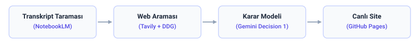

# Doğrulama Metodolojisi

Bu çalışma, **Utku Şen** tarafından hazırlanan haftalık siber güvenlik programı **"Siber Alemden Havadisler" (S.A.H)** serisindeki şahsi tahminlerin incelendiği 4 adımlı bir yapay zeka akışıdır.

---

## Doğrulama Akışı

---

## Aşamaların Detayları

### 1. Aşama: Videoları Tek Tek Tarama (notebooklm-py ve Kaynak İzolasyonu)

- **Bağlam Karışıklığı Sorunu:** 179 video ve 200 saati aşkın konuşma metni tek bir yapay zeka oturumuna verildiğinde, model bölümleri birbirine karıştırabilir ve hayali bağlantılar kurabilir.
- **Kaynak İzolasyonu (`source_ids=[vid_id]`):** Açık kaynaklı `notebooklm-py` kütüphanesiyle Google NotebookLM defterindeki her videoya tek tek istek atıldı. Model her adımda yalnızca incelediği videonun konuşma metnine odaklandı, diğer bölümlerin gürültüsünden tamamen uzak tutuldu.
- **Haber ve Tahmin Ayrımı:** Akamai'nin Linode'u satın alması veya bir şirketin güvenlik güncellemesi yayınlaması gibi gelişmeler haberdir, bu yüzden elendi. Sadece Utku'nun bu haberleri yorumlarken kendi tecrübesiyle dile getirdiği şahsi tahmin ve öngörüler toplandı.
- **Videoları Deftere Ekleme:** YouTube oynatma listesindeki 179 videonun linklerini tek tek elle kopyalamak yerine [TunePocket Playlist to Text Converter](https://www.tunepocket.com/youtube-playlist-to-text-converter/) aracıyla topluca çıkardık. Ardından NotebookLM'e yapıştırarak konuşma metinlerinin otomatik olarak deftere çekilmesini sağladık.
- **Kaynak NotebookLM Defteri:** Taramada kullanılan 179 YouTube videosunun konuşma metinlerini içeren Google NotebookLM defterine buradan doğrudan göz atabilirsiniz: **[Google NotebookLM Defteri](https://notebook.google.com/notebook/f2e75aa1-ef9d-4e1c-a281-95885383785a)**

### 2. Aşama: Web Araması (Tavily + DuckDuckGo)

- **Tavily:** Yabancı teknik kaynaklarda (BleepingComputer, The Hacker News vb.) iddiayla ilgili en güncel haber paragraflarını çekmek için kullanıldı.
- **DuckDuckGo:** Türkçe yerel haberleri ve alternatif siteleri tarayarak kanıt listesini zenginleştirmek için devreye girdi.

### 3. Aşama: Karar Modeli (`gemini-decision-1`)

- Uzun metinler üreten klasik sohbet modelleri yerine, doğrudan sonuç sınıfları üzerinden kesin yüzdeler veren Google Gemini Decision 1 modeli tercih edildi.
- **Sonuç Sınıfları:**
  - **TUTTU:** Öngörü somut olarak gerçekleşti ve internette açık delili var.
  - **KISMEN TUTTU:** Öngörünün temel fikri doğru çıktı ancak zamanlama veya kapsamda kısmi sapma oldu.
  - **TUTMADI:** Öngörünün tam tersi gerçekleşti veya aradan geçen yıllara rağmen beklenti boşa çıktı.
  - **BELİRSİZ:** İnternetteki bulgular iddiayı doğrulamak ya da çürütmek için yetersiz kaldı veya iddianın vadesi henüz dolmadı.
- **Ters Köşe Tahminler:** Eğer Utku bir teknolojinin tutmayacağını ya da bir projenin yasaklanacağını söylediyse ve aradan geçen zamanda o şey gerçekten tutmadıysa, bu iddia haklı olarak `TUTTU` kabul edildi.

### 4. Aşama: Başarı Oranı Nasıl Hesaplandı?

Tahmin platformlarında (Metaculus veya Polymarket gibi) süresi henüz dolmamış veya gerçekleşip gerçekleşmediği şu an bilinemeyen iddialar başarısızlık sayılmaz.

- **Toplam Tahmin:** 370
- **Belirsiz (Vadesi dolmamış veya kanıtı yetersiz):** 98
- **Sonuçlanan Tahminler:** 272 (150 Tuttu + 77 Kısmen Tuttu + 45 Tutmadı)
- **Doğrulanan Başarı Oranı:** `(150 + 77) / 272 = %83.5`

Örneğin hedefi 2028 veya 2030 olan uzun vadeli bir tahmini bugünden gerçekleşmemiş gibi hesaba katmak yanıltıcı olurdu. Bu sebeple başarı oranı, sonucu kesinleşen 272 tahmin üzerinden (%83.5) hesaplandı. Vadesi henüz gelmemiş iddiaların da dahil olduğu genel dağılım ise tablomuzda ayrıca şeffaf bir şekilde gösterilmektedir.

### 5. Aşama: Sıfır Maliyet Altyapısı

Bu projeyi yürütürken yüksek token faturalarına girmeden tamamen ücretsiz geliştirici imkanları kullanıldı:

- **NotebookLM:** 179 videonun tüm konuşma metinleri NotebookLM'in ücretsiz web arayüzü üzerinden tarandı. Bu sayede yüzlerce saatlik videoyu LLM'lere tek tek okutmanın getireceği devasa API maliyeti sıfıra indi.
- **Tavily AI (Aylık 1.000 Ücretsiz İstek):** Her iddia için yalnızca 1 arama kredisi harcandı, doğrudan yabancı kaynaklardan en kritik haber kesitleri alındı.
- **DuckDuckGo:** Tamamen ücretsiz arama motoru sayesinde Türkçe yerel kaynaklar tek kuruş harcanmadan tarandı.
- **Gemini Decision 1:** Google AI Studio'nun ücretsiz katmanında çalıştırıldı. Uzun metin üretmek yerine doğrudan karar yüzdelerini verdiği için son derece hızlı ve ücretsiz çalıştı.
- **GitHub Pages:** Sitenin derlenmesi ve yayını GitHub Actions ve GitHub Pages'in ücretsiz açık kaynak altyapısıyla sağlandı.

---

## Önemli Not (Yapay Zeka Uyarısı)

!!! warning "Sonuçlara körü körüne güvenmeyin!"
    - **Tamamen Yapay Zeka Tarafından Üretildi:** Bu sitedeki tüm özetler, internet aramaları ve doğruluk kararları insan müdahalesi olmadan yapay zeka modelleri tarafından oluşturuldu.
    - **Yüzde Yüz Doğruluk Garantisi Yok:** Modeller konuşma dilindeki esprileri veya kinayeli ifadeleri bazen yanlış yorumlayabiliyor, arama motorları da konudan bağımsız sayfalar getirebiliyor. Sonuçlar mutlak kesin bir doğru değil, model değerlendirmesidir.
    - **Amaç:** Bu çalışma Utku Şen'e karne ya da not verme amacı taşımıyor. Eski siber güvenlik muhabbetlerini anmak ve yapay zekanın araştırma yeteneklerini eğlenceli bir senaryoda denemek için hazırlandı.
    - **Düzeltmeler:** Hatalı değerlendirildiğini düşündüğünüz maddeler için GitHub üzerinden Issue veya Pull Request açabilirsiniz.
